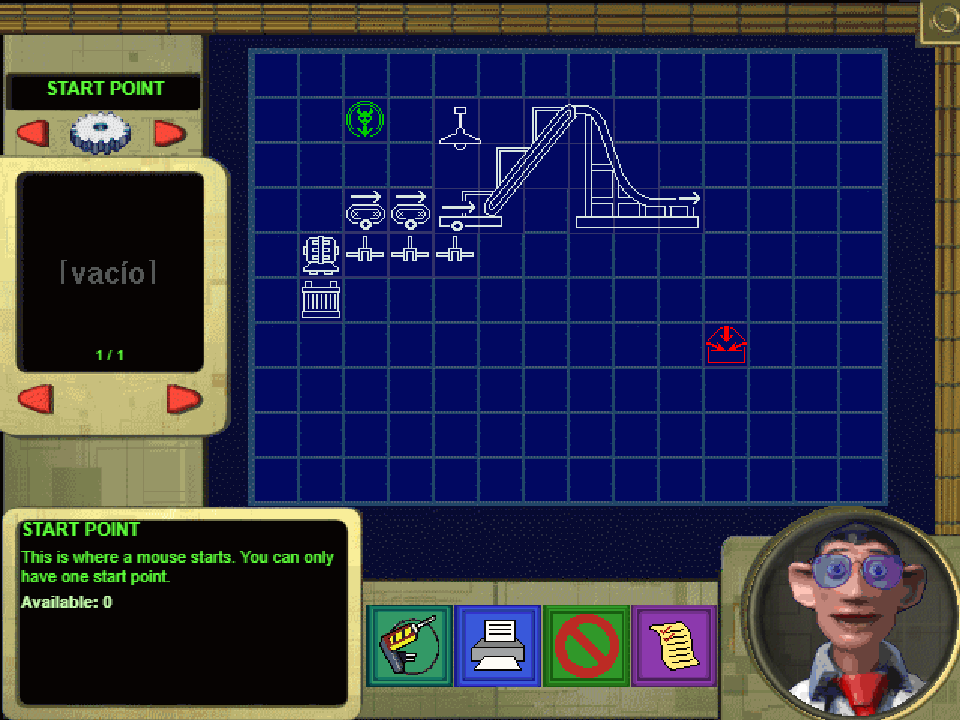
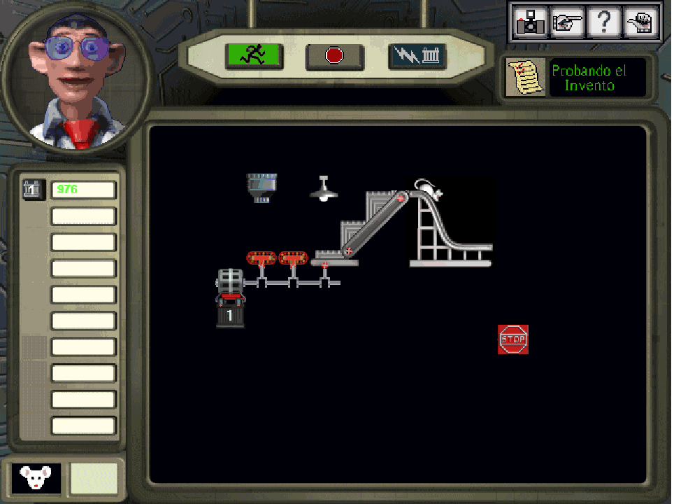
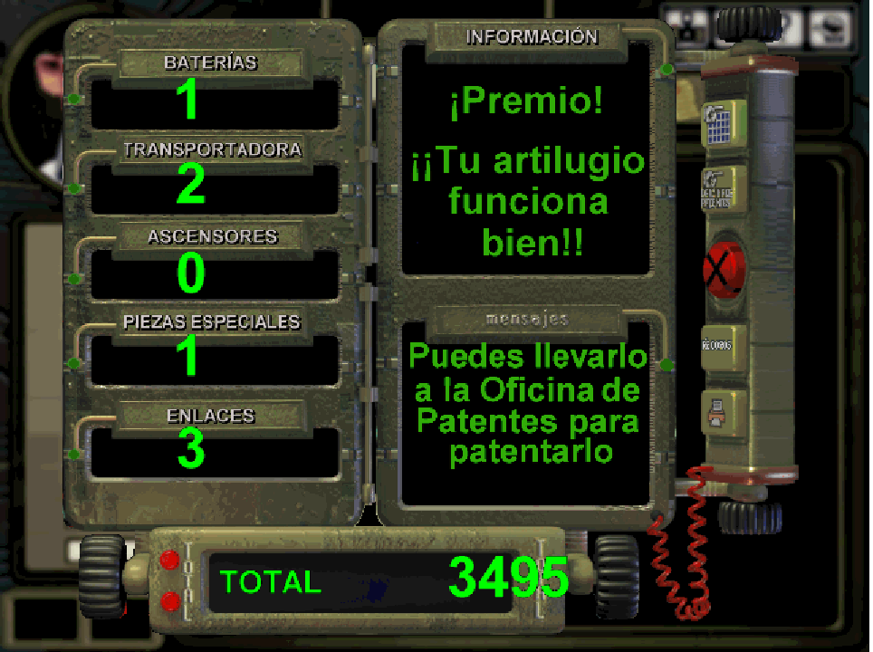
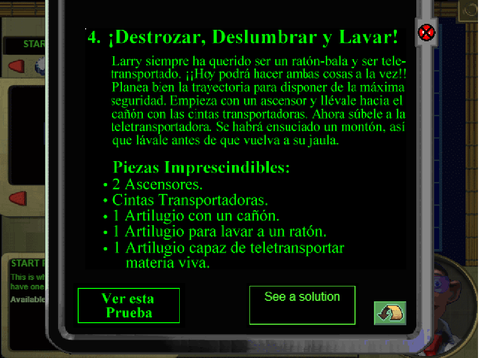
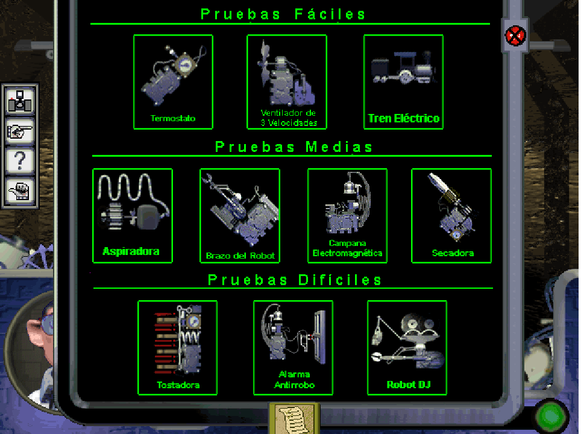
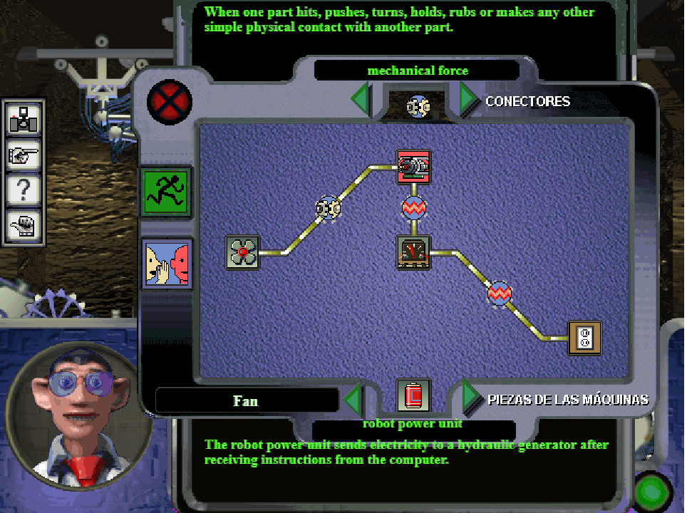
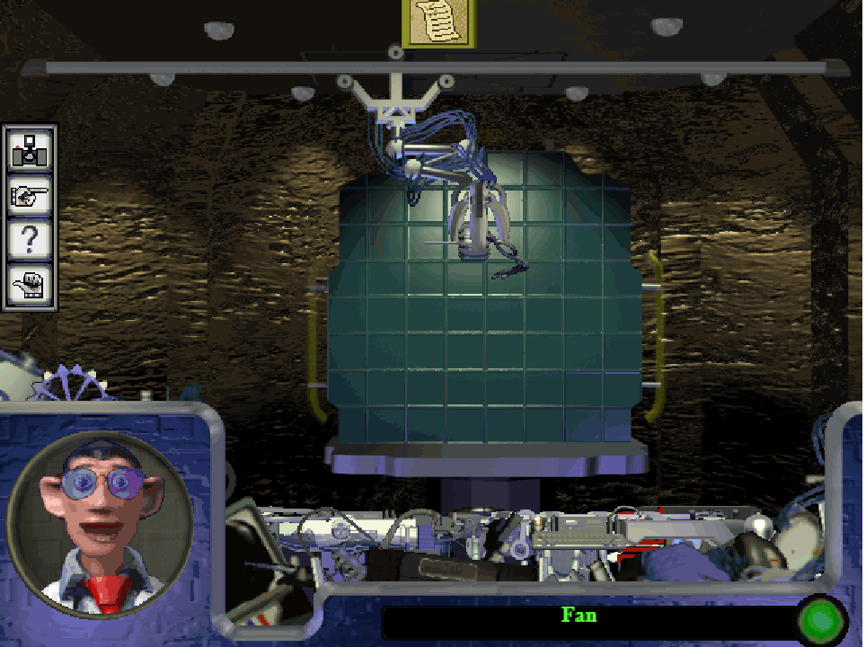
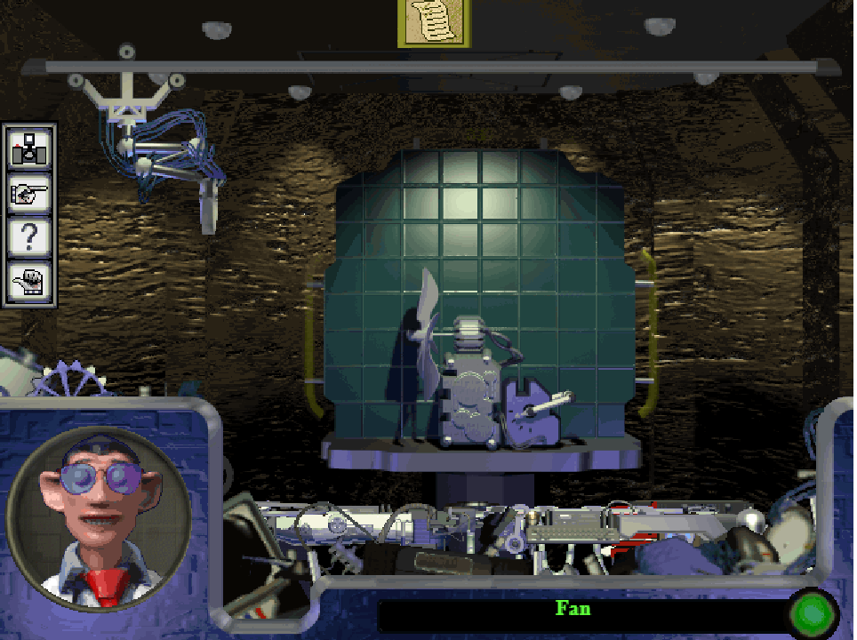
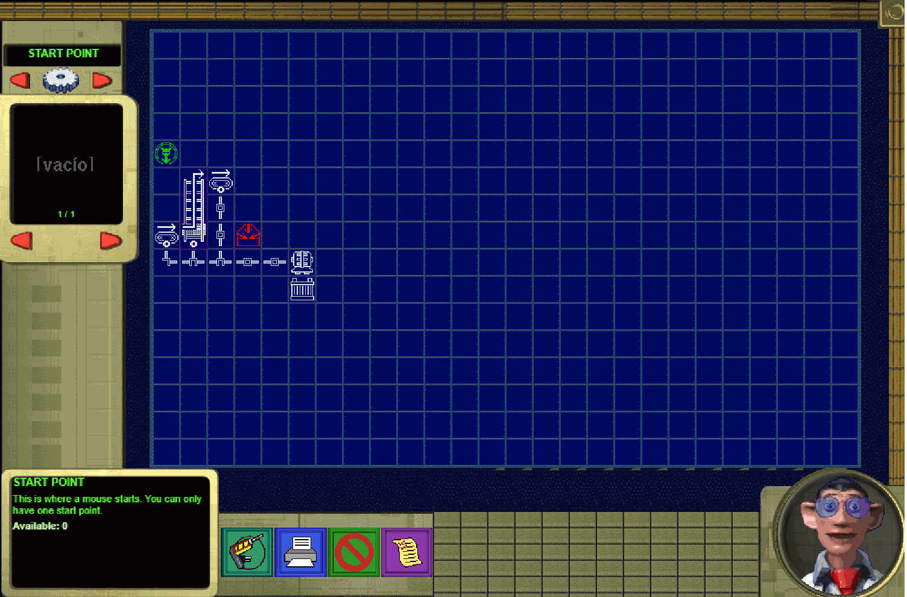

# Invention Studio, rebuilt for the browser

A browser remake made with Claude of two activities from Discovery Channel's *Invention Studio* (1996, Spanish release *Taller de inventos*):

- **Larry's Maze** (*Laberinto de Larry*): build a contraption on the blueprint table and watch Larry the mouse run through it on the test floor. Includes the ten original challenges, the game's own solution blueprints, the score screen, and larger boards for free play.
- **Machine Workshop** (*Taller de máquinas*): wire up components and connections on a machine's blueprint, then watch the robot arm assemble it in the glass capsule. Ten machines to build.

The game logic was reverse-engineered from the game's own scripts. Graphics, animations, sounds and texts are decoded at run time from **your copy of the game**; nothing from the game is included in this repository.

| | |
|---|---|
|  |  |
|  |  |
|  |  |
|  |  |



## Playing

You need the game: the *Invention Studio* (*Taller de inventos*) CD, a copy of its folder, or an image of the CD (`.iso`).

* **Online (GitHub Pages)**: open the page and choose either the game folder or the `.iso` file. The files are read by your browser on your computer; nothing is uploaded. You'll be asked again on each visit.

* **Locally**: put the game files in a folder called `invention/` next to `web/` (or anywhere, see below) and serve the repository root:

```sh
python -m http.server 8765
```

Then open <http://localhost:8765/web/>. If the files are elsewhere, pass their URL with `?game=/path/to/files/`, or just pick the folder or image on the start screen.

The toolbar under the screen switches between the two games and between English and Spanish. The game's own graphics and Howard's voice are in Spanish (the files are the Spanish release); everything the app draws as text follows the selected language. Settings, the current game, saved blueprints and completed challenges are remembered in the browser.

### Larry's Maze

- The red arrows at the top left pick a part category; the ones lower down pick the variant. The mouse wheel over the left panel does the same.
- Drag a part from the viewer onto the grid, or click it and click again where it goes. Drag a placed part off the grid, or right-click it, to remove it.
- Buttons under the grid: test the invention, save/open blueprints, clear everything, challenges.
- With a challenge selected, hold the face button under the grid to see the game's solution.

Power rules:
- A battery only works with a motor directly above it, and power leaves the motor through its left and right sides.
- Power travels along connectors whose arms meet, and reaches a conveyor, elevator or gadget only from a connector directly below it with an arm pointing up.
- Each battery has 1000 charge and loses its connected load on every mouse step.

### Machine Workshop

1. Pick a machine in the chooser (the scroll button at the top).
2. Fill the blanks of its blueprint: square slots take components, round slots take connections. Browse with the arrows or the mouse wheel; drag a piece into place, or click to pick it up and click a blank to drop it. Pre-placed pieces are locked.
3. Press the green running-man button. If the blueprint is right, the robot arm builds the machine and it starts working; if not, sparks fly, Howard gives a hint, and the wrong pieces are removed.

## Repository layout

| path | what |
|---|---|
| `web/` | the web app (static files, no build step) |
| `web/js/formats.js` | PAG/PFL decoders (LZ sprite frames, RLE bitmaps), JS port of `tools/invstudio.py` |
| `web/js/data.js`, `model.js` | maze rules: parts, placement, power, mouse simulation, scoring |
| `web/js/app.js` | file access (folder, ISO, HTTP), assets, sound, Howard, maze screens |
| `web/js/taller.js`, `taller_data.js` | the machine workshop and its data |
| `web/js/i18n.js` | Spanish/English texts |
| `docs/MAZE_RULES.md` | the reverse-engineered maze rules, with citations into the script listings |
| `docs/TALLER_RULES.md`, `taller_machines.json` | the reverse-engineered workshop rules and machine tables |
| `docs/VM_NOTES.md` | how the game's script interpreter works |
| `tools/` | Python and PowerShell tools used for the reverse engineering (below) |

### Tools

All Python tools use only the standard library (Python 3).

| tool | what |
|---|---|
| `invstudio.py` | decoders for `.PFL` sprites, `.PAG` chunk streams and bitmaps; PNG writer |
| `pagvm.py` | disassembler for the game's bytecode scripts: `python pagvm.py FILE.PAG -o out.txt` |
| `list_chunks.py` | list a page's chunks and graphic slots |
| `code_table.py` | print data tables from a disassembly listing by token address |
| `dump_str.py` | print `.STR` text records |
| `contact_sheet.py` | draw all bitmaps of a page on one PNG, labelled with chunk numbers |
| `page_thumbnails.py` | thumbnail the background of every page, to find screens |
| `export_assets.py` | export the maze graphics to PNG plus a JSON manifest |
| `extract_taller.py`, `gen_taller_data.py` | extract the workshop tables from `70/BD7000.PAG` and build `web/js/taller_data.js` |
| `make_test_iso.py` | build a small ISO 9660 image from some game folders, to test the CD-image loader |
| `crop_strip.py` | crop the same box from several screenshots and tile them |
| `ida_dump.py` | IDAPython script that dumps pseudocode, strings and imports of the game executable |
| `screenshot.ps1`, `make_screenshots.ps1` | headless Edge screenshots of the app; regenerate `docs/screenshots` |

### Testing hooks

The page accepts query parameters for scripted checks:
- `design=<base64 JSON>`, `size=<cols>x<rows>`, `ch=<1..10|0>`: load a design, set the board size, set the challenge (0 is free play).
- `auto=test|run|score|confirm|saves|challenges|taller`: open that screen on load (`taller` also takes `machine=N`, `solve`, `wrong`, `build`, `hint`, `help`).
- `lang=es|en`, `speed=<n>`, `game=<url>`, `iso=<url>`: language, simulation speed, game files URL, CD image URL.
- `tick=timer`: drive the loop from timers instead of animation frames, for headless browsers.

## Known differences from the original

- If the mouse waits on an unpowered part and no battery is draining, the original waits forever; this version reports "no power" after a few steps.
- Not implemented: the photo album, the records table, the patent office, the workshop's guided lamp tutorial, and the workshop's parking column for misplaced pieces (wrong pieces are simply removed).
- Howard's lip sync follows the game's method (random mouth shapes while he talks) but isn't driven by the sound level.
- A few details are best guesses and are marked as such in the docs, such as the extra requirement of challenges 6 and 8.

## Why?

Well, there's some nostalgia/fun to be had with this game, but it doesn't really work under VMware. Not only that, but expanding the maze size is a nicer addition. AI made all of this, I know it's wrong to vibecode stuff, but I couldn't be bothered :).

Please feel free to provide some feedback under the "Issues" tab!

## Legal

*Invention Studio* / *Taller de inventos* is © Discovery Communications and its respective owners. This project contains no game data; it reads the files from a copy you provide. It's an unofficial fan project for preservation and study.
